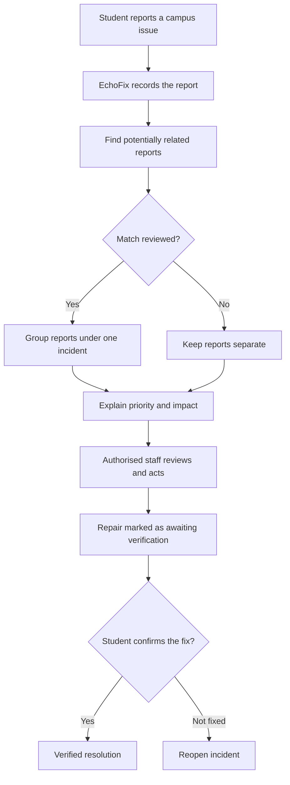

[Uploading README.md…]()

# EchoFix 💜
### Your campus, heard.

**Turn scattered campus complaints into shared incidents, prioritised action, and verified fixes.**

*An AI-assisted campus incident intelligence prototype.*

---

## 🚀 The problem

On a campus, the same issue can be reported in multiple places and different words: a broken water cooler, unreliable Wi-Fi, a maintenance concern, or a facility that has stopped working. When reports remain scattered, staff can struggle to understand the scale of a problem, decide what to address first, and communicate whether it was fixed.

**EchoFix brings the reports together around the issue—not just the ticket.** It is designed to help students raise concerns, help campus teams see shared incidents, and make resolution progress easier to follow.

## ✨ Product vision

- **Report an issue:** Submit a campus concern with a description, location, category, and optional supporting evidence.
- **Echo Radar:** Visualise incidents and potentially related reports in an interactive interface.
- **Same Here:** Let students support an existing issue rather than repeatedly submitting the same complaint.
- **Ripple Score:** Explain prioritisation using transparent factors such as severity, time open, and distinct affected students.
- **Fix Replay:** Follow an issue from report to repair and student verification.
- **Campus Connect:** Find approved campus contacts and relevant services.
- **CampusVerse roadmap:** Explore an interactive campus, discover events, participate in student communities, and find career or club opportunities.

> **Prototype note:** The live demo and this repository may not expose every item in the product vision. Only treat a feature as implemented when it can be demonstrated in the current app and its underlying action/data flow works. See [FEATURES.md](FEATURES.md) for a verification checklist.

## 🧭 How EchoFix works

## 🎨 Design direction

EchoFix uses a bright, premium visual identity built around:

| Colour | Role | Hex |
|---|---|---|
| White | Primary canvas | `#FFFFFF` |
| Purple | Brand and primary actions | `#7047EB` |
| Blue | Interactive and information elements | `#3987FF` |
| Yellow | Highlights and discoveries | `#FFD84D` |

The interface direction is student-first, responsive, and animation-rich—while keeping reports, status labels, and actions readable and accessible.

## 🧑‍🎓 Who is it for?

- **Students:** Report issues, follow progress, support shared incidents, and confirm whether repairs work.
- **Campus staff:** Review reports, investigate related incidents, prioritise work, and record repair progress.
- **Campus administrators:** Configure approved contacts, oversee incident workflows, and maintain appropriate access controls.

Access to staff tools and private information should be restricted to authorised users. Selecting a staff role on a login screen must not by itself grant staff permissions.

## 🛠️ Built with

- **Base44** — app-building and hosting platform for the current live prototype.
- **GitHub** — source-code versioning and project collaboration.
- **AI integration** — document the exact provider, model, and version here only after confirming it is genuinely connected and tested.

The exact frontend framework, data services, and integrations depend on the source exported or synced from Base44. See [docs/source-export-and-setup.md](docs/source-export-and-setup.md) before claiming the repository is independently runnable.

## ▶️ Live demo

**[Open EchoFix](https://echo-fix-pulse.base44.app)**

For a quick walkthrough, see [the demo script](docs/demo-script.md). Use fictional/demo data for public presentations; do not publish real students' personal details, ID-card numbers, private messages, or exact locations.

## 🧪 Prototype verification

Before presenting a capability as working, confirm it end-to-end—not just visually. The checklist in [FEATURES.md](FEATURES.md) covers the key test flows.

A successful core demo should show a student report being saved, related reports being reviewed rather than silently merged, an authorised staff action, and a resolution being confirmed or reopened. Clearly label simulated data and disclose any feature that still requires configuration.

## 🔐 Privacy and safety principles

- Collect only the data required for the workflow.
- Keep student contact details and private reports private by default.
- Use server-side/backend permissions for staff-only actions.
- Do not expose credentials, API keys, or environment secrets in source control.
- Emergency/SOS functions must not claim an alert was delivered unless a real configured integration confirms delivery.
- Distinguish official event information from community-submitted or unverified reports.
- Provide reporting and moderation paths for community spaces.

See [SECURITY.md](SECURITY.md) for vulnerability reporting guidance.

## 🧑‍💻 Getting the source code running

The hosted demo is built with Base44. A GitHub repository needs the actual application source—not only this README—to serve as a source-code submission.

1. Sync or export the EchoFix app from Base44 into this repository.
2. Inspect the exported project files and confirm no credentials or private student data are included.
3. Follow the setup instructions generated for the actual exported project. Do not assume a framework or command until you inspect its `package.json` or platform instructions.
4. Add a sanitized `.env.example` containing variable **names** and explanatory placeholders only. Keep actual `.env` files out of Git.
5. Run the app using the project's documented command and verify the main flow.

See [docs/source-export-and-setup.md](docs/source-export-and-setup.md).

## 🤝 Contributing

Ideas, usability feedback, bug reports, and improvements are welcome. Read [CONTRIBUTING.md](CONTRIBUTING.md) before opening a pull request. Please do not include real personal information in issues, screenshots, sample data, or test fixtures.

## 📄 License

This project is released under the MIT License; see [LICENSE](LICENSE). Confirm that the code and third-party assets you commit are yours to distribute and that their terms permit this license. Third-party models, libraries, fonts, icons, and images may have separate licenses.

## 👋 Project

**EchoFix — Your campus, heard.**

Live demo: https://echo-fix-pulse.base44.app  
GitHub: https://github.com/abhishek5127-hash/echofix
